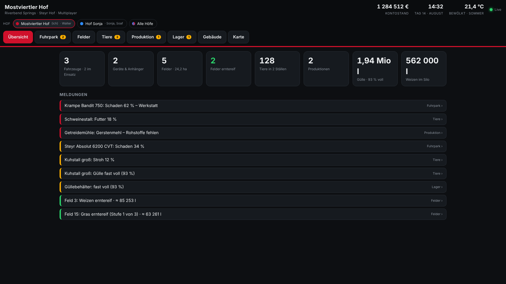
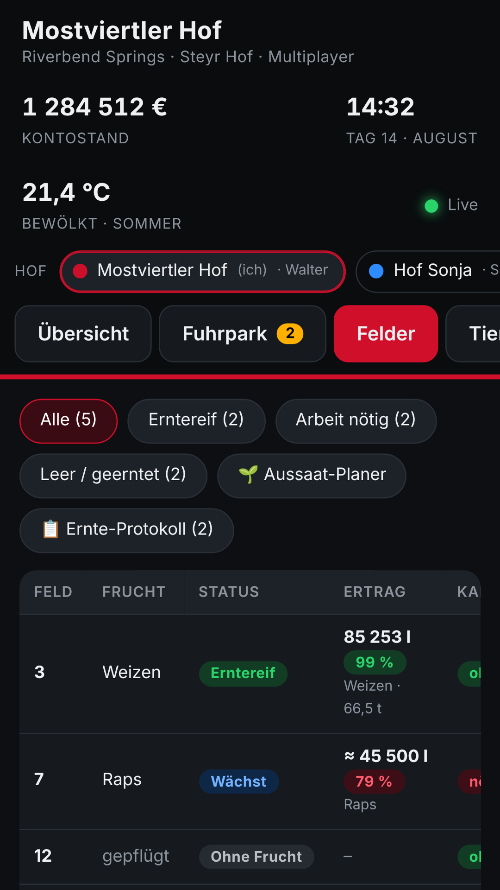
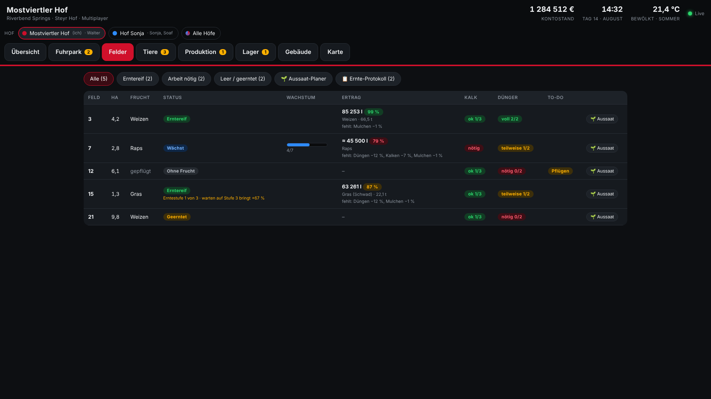
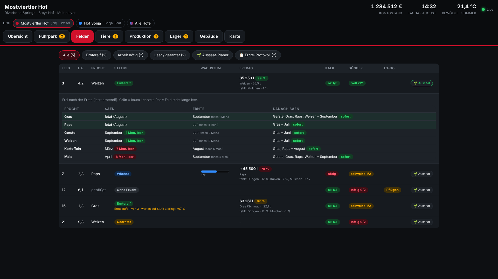
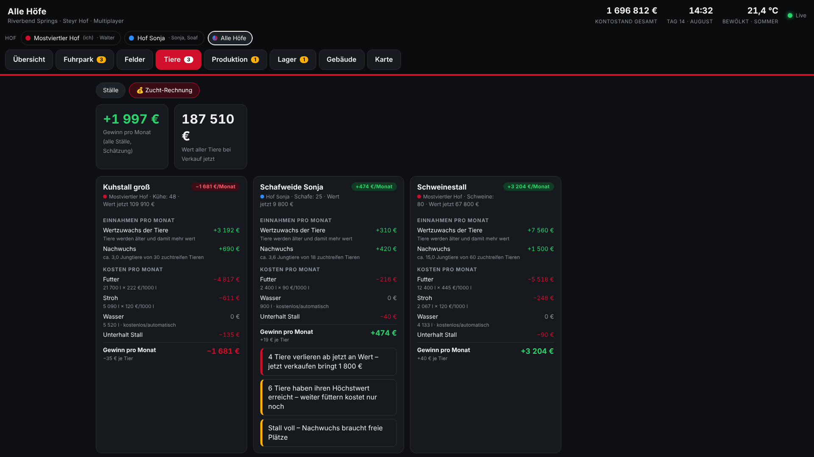
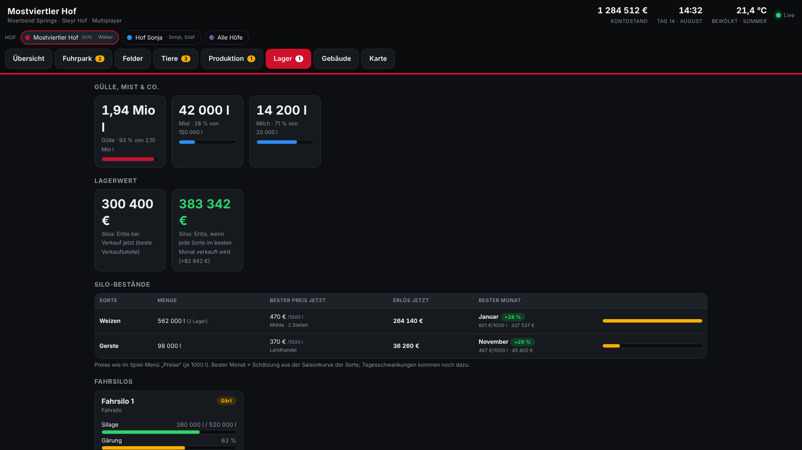
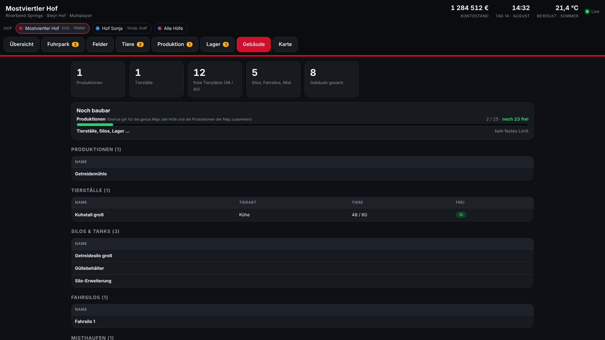
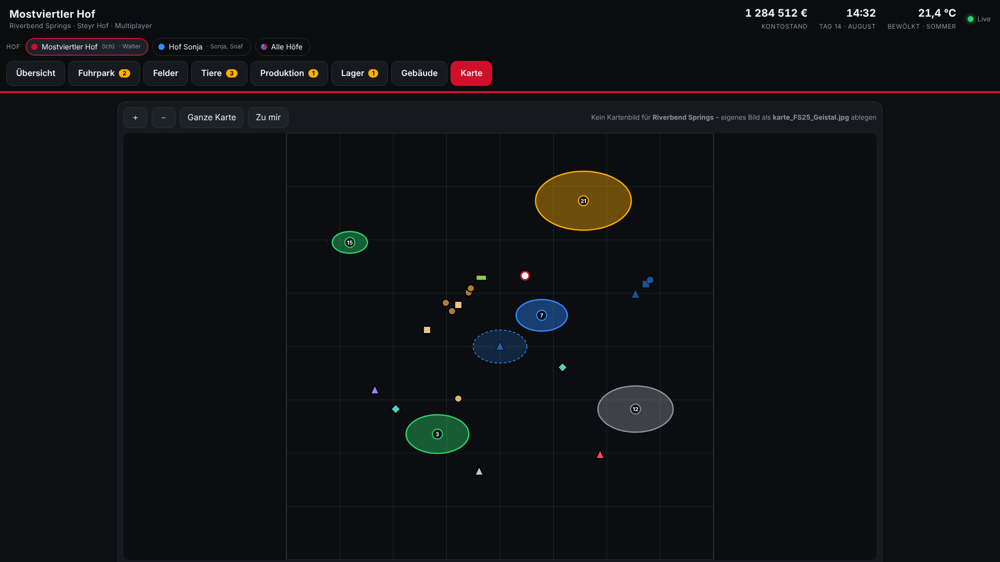

# HofDaten – dein Hof aus dem LS25 auf PC, Tablet und Handy

**HofDaten** zeigt alle wichtigen Daten deines Hofs aus dem **Landwirtschafts-Simulator 25 (Farming Simulator 25)** in einem eigenen Fenster am PC oder auf Tablet und Handy im Heimnetz, während du spielst. Du siehst Fuhrpark, Felder mit erwartetem Ertrag, Tiere mit Zucht-Rechnung, Lager mit Verkaufspreisen, Gebäude und eine Karte.



**[⬇ Download – neueste Version](../../releases/latest)**

---

## Was du bekommst

| Datei | Wofür |
| --- | --- |
| `FS25_HofDaten.zip` | Der **Mod** fürs Spiel. Schreibt alle 5 Sekunden die Daten deines Hofs in eine Datei. |
| `HofDaten-App.zip` | Das **PC-Programm** (empfohlen). Zeigt die Daten in einem eigenen Fenster und stellt sie für Tablet und Handy bereit. |
| `HofDaten-Server.zip` | Die **Alternative** zur App: ein kleines Programm mit schwarzem Fenster, die Seite öffnet sich im Browser. |

Du brauchst den Mod **und** entweder die App oder den Server.

## Installation

### 1. Mod einbauen

1. `FS25_HofDaten.zip` **nicht entpacken**, sondern so wie sie ist in den Mod-Ordner legen:
   `Dokumente\My Games\FarmingSimulator2025\mods`
2. Spiel starten, den Mod beim Spielstand aktivieren und den Spielstand laden.

### 2. App starten

1. `HofDaten-App.zip` entpacken, z. B. nach `Dokumente\HofDaten-App`.
2. `HofDaten.exe` starten. Tipp: Rechtsklick → „An Taskleiste anheften“.
3. **Beim ersten Start:**
   - Windows SmartScreen meldet „Der Computer wurde durch Windows geschützt“ → **Weitere Informationen** → **Trotzdem ausführen**. Die exe ist nicht signiert, das ist bei kleinen, selbst gebauten Programmen normal.
   - Die Windows-Firewall fragt nach Netzwerkzugriff → **Private Netzwerke** erlauben, sonst klappt es am Tablet nicht.

Voraussetzung: Windows 10/11 (64 Bit) mit .NET Framework 4.8 und Microsoft Edge WebView2. Beides ist bei aktuellem Windows schon dabei.

### 3. Tablet oder Handy

1. Tablet oder Handy ins **selbe WLAN** wie den PC.
2. Die Adresse steht in der App rechts oben (oder unter **Extras → Adresse fürs Tablet**), z. B. `http://192.168.0.20:8025`. Sie im Browser öffnen.
3. Im Browser-Menü **„Zum Startbildschirm hinzufügen“**, dann startet HofDaten wie eine App im Vollbild.



## Was HofDaten zeigt

### Übersicht
Kontostand, Zeit, Wetter, Kennzahlen und alle Meldungen auf einen Blick: Tank leer, Schaden, Futter knapp, Feld erntereif, Produktion steht, Lager voll …

### Fuhrpark
Jedes Fahrzeug und Gerät: Diesel, AdBlue, Ladung, Schaden, Betriebsstunden, wer gerade fährt, ob ein Helfer arbeitet.

### Felder
Frucht, Status, Wachstum, **Kalk und Dünger** (grün/gelb/rot) und der **erwartete Ertrag** in Liter und Tonnen, samt dem, was noch Ertrag kostet. Beim Gras steht die **Erntestufe** dabei und wie viel das Warten auf die nächste Stufe bringt.



- **🌱 Aussaat-Planer:** was du auf einem leeren Feld jetzt säen kannst, wann es erntereif ist, was danach kommt und wie lange das Feld leer steht.
- **📋 Ernte-Protokoll:** bei jeder Ernte merkt sich HofDaten automatisch den erwarteten Ertrag.



### Tiere
Jeder Stall mit Anzahl, Gesundheit, Futter, Wasser, Stroh, Milch, Gülle und Mist.

**💰 Zucht-Rechnung** für reine Zuchttiere (Schweine, Mastrinder, Pferde): Wertzuwachs und Nachwuchs gegen Futter, Stroh, Wasser und Unterhalt, also der Gewinn pro Monat. Dazu Hinweise, wenn Tiere ab jetzt an Wert verlieren oder der Stall zu voll für Nachwuchs ist.



### Produktion
Jede Produktion mit ihren Linien, Rohstoffen und Erzeugnissen.

### Lager
Gülle, Mist, Gärreste und Milch gesamt, Silo-Bestände je Sorte, Fahrsilos mit Gärung, Ballen- und Palettenlager. Zu jeder Sorte der **beste Verkaufspreis jetzt**, der **Erlös** und der **beste Monat** zum Verkaufen.



### Gebäude
Alle gebauten Ställe, Produktionen, Silos und Hallen, freie Stallplätze und wie viele Produktionen auf der Map **noch gebaut werden können**.



### Karte
Felder, Fahrzeuge, Ställe, Lager, Produktionen und deine Position. Zum Zoomen, Ziehen und Antippen. Das Kartenbild holt sich die App automatisch aus der gespielten Map.



## Multiplayer

- Den Mod wie jeden anderen Mod auf den Server hochladen, die Mitspieler laden ihn automatisch mit.
- Jeder Spieler schreibt die Daten **auf seinem eigenen PC**. Auf einem Dedicated Server selbst ist der Mod inaktiv.
- Oben in der App schaltest du zwischen den Höfen um: eigener Hof, andere Höfe oder **„Alle Höfe“** mit Vergleichstabelle.
- Manche Werte fremder Höfe schickt das Spiel nicht an jeden Mitspieler. Dort stehen dann 0 oder alte Werte.

## Häufige Fragen

**Die App zeigt „keine Daten“.**
Ist der Mod im Spielstand aktiviert und der Spielstand geladen? Der Mod schreibt die Datei `Dokumente\My Games\FarmingSimulator2025\modSettings\FS25_HofDaten\hofdaten.xml`.

**Am Tablet geht nichts.**
Fast immer ist es die Firewall. Beim ersten Start „Private Netzwerke“ erlauben. Sonst in einer Administrator-Eingabeaufforderung:
```
netsh advfirewall firewall add rule name="HofDaten" dir=in action=allow protocol=TCP localport=8025 profile=private
```

**Verändert der Mod meinen Spielstand?**
Nein. Der Mod liest nur Spieldaten und schreibt sie in eine Datei auf deinem PC. Ins Internet wird nichts geschickt.

**Ich möchte es ohne Spiel ausprobieren.**
In der App: **? → Demo**. Beim Server: `http://localhost:8025/?demo`

**Fehler melden:**
Unter [Issues](../../issues) ein neues Problem anlegen. Am besten die Zeilen mit `[HofDaten]` aus `Dokumente\My Games\FarmingSimulator2025\log.txt` dazuschreiben.

---

HofDaten ist ein Fan-Projekt und kein offizielles Produkt von GIANTS Software. „Landwirtschafts-Simulator“ / „Farming Simulator“ sind Marken von GIANTS Software GmbH.
